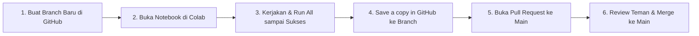

# 📖 PANDUAN KERJA PROYEK PCD 2026: TOPIK 5 (CITRA SERUPA)

Dokumen ini memandu seluruh alur kerja tim dari pengembangan di Google Colab, pengelolaan Git branch, Pull Request, hingga penerbitan GitHub Release untuk penilaian UTS (Tahap 1) dan UAS (Tahap 2).

---

## 🚀 1. Alur Kerja: Dari Colab ke Main lewat Pull Request

> [!IMPORTANT]
> **Branch `main` dikunci (protected)!** Anggota tidak dapat melakukan commit atau push langsung ke `main`. Setiap perubahan wajib melalui mekanisme branch dan Pull Request (PR) yang ditinjau oleh minimal 1 rekan anggota tim.



### Langkah-Langkah Praktis:
1. **Buat Branch Baru di GitHub:**
   - Kunjungi repositori proyek di browser atau aplikasi GitHub Mobile.
   - Klik menu dropdown branch (biasanya bertuliskan `main`), ketikkan nama branch baru, lalu klik **Create branch**.
   - **Standar Penamaan Branch:** `t5-[tahap]-[nama-anggota]`
     - Contoh: `t5-preprocessing-lukman`, `t5-klasik-anggota2`, `t5-modern-anggota3`, `t5-demo-anggota4`.
2. **Buka Notebook di Google Colab:**
   - Buka Google Colab (`colab.research.google.com`).
   - Pilih tab **GitHub**, masukkan URL repositori kelompok Anda.
   - Pilih branch yang telah Anda buat pada langkah 1, lalu klik notebook yang ingin dikerjakan.
3. **Hubungkan Google Drive & Kerjakan:**
   - Jalankan sel mount Google Drive:
     ```python
     from google.colab import drive
     drive.mount('/content/drive')
     ```
   - Pastikan folder Google Drive kelompok sudah dibagikan (*shared*) ke seluruh akun Google anggota tim dan dosen pengampu.
4. **Validasi Sebelum Menyimpan:**
   - Selalu klik menu **Runtime** ➔ **Restart and run all**. Pastikan seluruh sel berjalan lancar dari awal hingga akhir tanpa ada error (Slide 14).
5. **Simpan Hasil Pekerjaan ke GitHub:**
   - Klik menu **File** ➔ **Save a copy in GitHub...** (Simpan salinan di GitHub).
   - Pastikan memilih **Repository** dan **Branch** yang benar (sesuai branch kerja Anda, jangan pilih `main`).
   - Masukkan pesan commit yang jelas (contoh: `feat(preprocessing): implementasi CLAHE dan resize 224x224`).
6. **Buka & Review Pull Request (PR):**
   - Buka repositori di GitHub, klik tombol **Compare & pull request**.
   - Berikan deskripsi singkat apa saja perubahan yang dibuat.
   - Minta 1 rekan tim untuk meninjau (*review & approve*).
   - Setelah diapprove, klik **Merge pull request** ➔ **Confirm merge**.

---

## 📸 2. Aturan Foto Mandiri (Wajib 15 Foto per Anggota)

Sesuai aturan dosen (Slide 5, 7, dan 16):
- Tim beranggotakan **4 orang** wajib mengumpulkan **total minimal 200 citra**, di mana **60 citra berasal dari foto sendiri** (15 foto per anggota).
- **Syarat Foto Sendiri:**
  1. Diambil menggunakan kamera smartphone masing-masing anggota.
  2. Fokus pada pakaian/busana (tampak depan, samping, atau flat lay).
  3. **Wajib disensor/dibaurkan (*blur*) jika memperlihatkan wajah** demi menjaga privasi data (Slide 16).
  4. Resolusi gambar diperkecil terlebih dahulu (misal: panjang sisi maksimal 800–1000 px) sebelum diunggah ke folder sampel agar ukuran file ringan (< 25 MB per file).
  5. **Wajib di-commit dari akun GitHub masing-masing anggota** agar tercatat dalam histori kontribusi individu.

---

## 🏷️ 3. Mekanisme Pengumpulan (GitHub Release)

Dosen **tidak menerima laporan tertulis dalam bentuk dokumen Word/PDF cetak** (Slide 2 & 9). Seluruh penilaian diambil dari **README.md** dan **GitHub Release**.

### Pengumpulan Tahap 1 (UTS - Batas: Minggu, 8 November 2026 pukul 23.59 WIB):
1. Pastikan seluruh Pull Request untuk dataset, anotasi, dan notebook preprocessing telah di-merge ke branch `main`.
2. Di halaman repositori GitHub, buka menu **Releases** di sebelah kanan (atau URL `.../releases`).
3. Klik tombol **Draft a new release**.
4. Pada kolom **Choose a tag**, ketikkan persis: `tahap-1` lalu klik *Create new tag*.
5. Judul rilis: `Pengumpulan Tahap 1 (UTS) - Dataset & Preprocessing`.
6. Tuliskan ringkasan singkat hasil pengerjaan Tahap 1.
7. Klik tombol hijau **Publish release**.
8. Salin (*copy*) tautan rilis tersebut (contoh: `https://github.com/.../releases/tag/tahap-1`) dan tempelkan ke form/tugas portal Moodle kampus.

### Pengumpulan Tahap 2 (UAS):
1. Langkah sama persis, gunakan tag persis: `tahap-2`.
2. Pastikan link demo **Hugging Face Spaces** dan tabel komparasi Klasik vs Modern sudah terpampang jelas di `README.md`.
